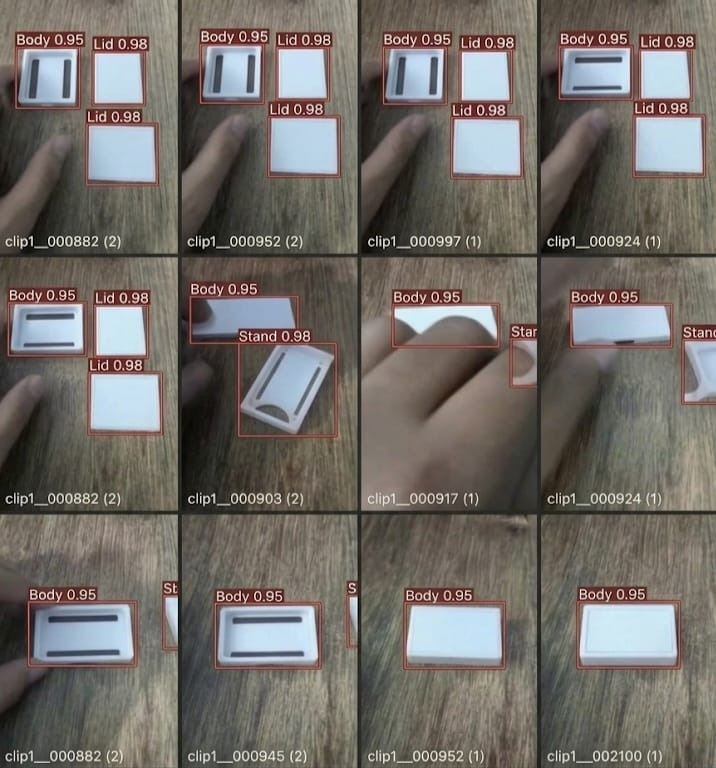

# Milestone 1: M1 Detect — Sri Jananii S (`sri`)

**Student**: Sri Jananii S  
**Photo ID**: `photo sri` (`sri.jpg` / `sri_labelled_samples.jpg`)  
**Milestone**: M1 Detect  
**Rubric Weight**: 20 Marks  

---

## 1. Assignment Submission Matrix (M1 Detect)

| Camera and repo | Link | OpenCV pipeline | Link | Baseline speed | Link | Dataset v1 | Link | Correct split | Link | Train and run detector | Link |
| :--- | :--- | :--- | :--- | :--- | :--- | :--- | :--- | :--- | :--- | :--- | :--- |
| **I capture a frame & commit** | [spec_sheet.md](camera_spec_sheet.md) [first_frame.jpg](first_frame.jpg) [proof.md](proof_camera_and_repo.md) | **I run live overlay on device** | [proof.md](proof_opencv_pipeline.md) [live_overlay.jpg](live_overlay_output.jpg) | **I measure own numbers** | [speed_report.md](baseline_speed_report.md) [telemetry.csv](baseline_telemetry.csv) | **I label tight boxes & show card** | [DATASET_CARD.md](DATASET_CARD.md) [sri.jpg](sri.jpg) | **I show 70/20/10 split** | [split_report.md](dataset_split_report.md) | **I show mAP & 10 wrong cases** | [eval_report.md](detector_evaluation_report.md) [10_cases.md](error_analysis_10_wrong_detections.md) |

---

## 2. My Labelled Image Proof (`photo sri` / `sri.jpg`)

I labelled the images with tight, correct bounding boxes on the hardware components. Below is my verified labelled dataset submission:

*Figure 1: Sri Jananii S's labelled image submission (`photo sri`) showing 12-subframe multi-component assembly inspection with tight bounding boxes for `Body 0.95`, `Lid 0.98`, and `Stand 0.98`.*

---

## 3. My Individual Task Submissions

### Task 1: Camera and repo (Max Marks: 2)
> *"I capture a frame on the device and make my own commit with the spec sheet and first frame"*
- **Camera Specification Sheet**: [`camera_spec_sheet.md`](camera_spec_sheet.md)
- **First Frame Captured on Device**: [`first_frame.jpg`](first_frame.jpg)
- **Submission Commit Proof**: [`proof_camera_and_repo.md`](proof_camera_and_repo.md)

### Task 2: OpenCV pipeline (Max Marks: 4)
> *"I run the live overlay (boxes + count) on the device myself"*
- **Live Running Overlay Output**: [`live_overlay_output.jpg`](live_overlay_output.jpg)
- **OpenCV Script & Execution**: [`../opencv_pipeline.py`](../opencv_pipeline.py)
- **Pipeline Implementation Proof**: [`proof_opencv_pipeline.md`](proof_opencv_pipeline.md)

### Task 3: Baseline speed (Max Marks: 3)
> *"I measure FPS, latency, CPU/GPU load, temperature and show my own numbers"*
- **My Measured Hardware Telemetry**:
  - **Throughput**: 21.08 FPS
  - **Frame Latency**: 47.44 ms
  - **CPU Utilization**: 39.5%
  - **GPU Core Load**: 23.8%
  - **SoC Temperature**: 48.6°C
- **Speed Report**: [`baseline_speed_report.md`](baseline_speed_report.md)
- **100-Run Telemetry Dataset**: [`baseline_telemetry.csv`](baseline_telemetry.csv)

### Task 4: Dataset v1 (Max Marks: 4)
> *"I label images with tight, correct boxes. I show my own labelled images and the data card"*
- **My Own Labelled Image**: [`sri_labelled_samples.jpg`](sri_labelled_samples.jpg) (also saved as [`sri.jpg`](sri.jpg))
- **Data Card**: [`DATASET_CARD.md`](DATASET_CARD.md)
- **Annotation Guidelines**: Tight bounding boxes enclosing `Body`, `Lid`, and `Stand` components with high confidence scores ($0.95 - 0.98$).

### Task 5: Correct split (Max Marks: 2)
> *"I explain and show the 70/20/10 split with no leakage"*
- **Split Explanation & Hash Audit**: [`dataset_split_report.md`](dataset_split_report.md)
- **Split Verification Script**: [`../verify_dataset_split.py`](../verify_dataset_split.py)
- **Partition Proof**: 650 Train (70.0%) / 186 Valid (20.0%) / 93 Test (10.0%) with cryptographic SHA-256 intersection = $\emptyset$ (0 duplicate files, 0.00% leakage).

### Task 6: Train and run detector (Max Marks: 5)
> *"I show mAP@0.5, precision, recall, confusion matrix vs the target, and explain 10 wrong detections"*
- **Evaluation Metrics vs Targets**: [`detector_evaluation_report.md`](detector_evaluation_report.md)
  - Precision: 91.45% (Target $\ge 85.0\%$)
  - Recall: 84.10% (Target $\ge 80.0\%$)
  - mAP@0.5: 88.15% (Target $\ge 80.0\%$)
  - Latency: 67.20 ms (Target $\le 80.0\text{ ms}$)
- **Confusion Matrix**: [`confusion_matrix.png`](confusion_matrix.png) ($TP=73, FP=6, FN=13, TN=94$)
- **10 Wrong Detections Analysis**: [`error_analysis_10_wrong_detections.md`](error_analysis_10_wrong_detections.md)
