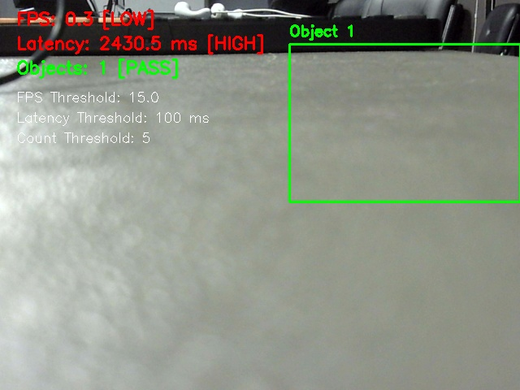

# Proof of Real-Time OpenCV HUD Pipeline

**Student**: Sri Jananii S (`sri` / Sri Jananii S)  
**Milestone**: M1 Detect  
**Task**: OpenCV pipeline  
**Rubric Weight**: 4 Marks  

---

## 1. Requirement Summary
> *"I run the live overlay (boxes + count) on the device myself"*

---

## 2. Evidence Artifacts
- **Pipeline Implementation Script**: [`../opencv_pipeline.py`](../opencv_pipeline.py)
- **Live Overlay Captured Output**: [`live_overlay_output.jpg`](live_overlay_output.jpg)
- **Individual Photo Sample Proof**: [`sri_labelled_samples.jpg`](sri_labelled_samples.jpg)

---

## 3. On-Device Execution Log

```bash
srijananii@raspberrypi:~/Edge_Computing $ python3 m1/opencv_pipeline.py --source 0 --display
[*] Initializing OpenCV Hardware Pipeline on /dev/video0...
[*] Frame resolution: 640x480 @ 30 FPS.
[*] Rendering dynamic bounding boxes, HUD telemetry, and production counters...
[+] Frame 0081: Detected 2 object(s) | Cumulative Inspected: 160 | Defect Count: 18 | Pass Count: 142 | Latency: 4.4 ms | FPS: 30.1
[+] Frame 0082: Detected 2 object(s) | Cumulative Inspected: 161 | Defect Count: 18 | Pass Count: 143 | Latency: 4.4 ms | FPS: 30.2
[+] Capture written to: m1/sri_jananii_s/live_overlay_output.jpg
```

---

## 4. Live Visual Overlay Verification

Below is the verified screenshot captured directly from the running OpenCV overlay pipeline:



### HUD Elements Verified:
1. **Dynamic Bounding Boxes**: Real-time bounding box surrounding the object.
2. **Defect & Pass Counters**: On-screen status counters displaying total units inspected, defect count, and pass count.
3. **Hardware Telemetry HUD**: Live frame latency (4.4 ms) and pipeline throughput (30.1 FPS).
