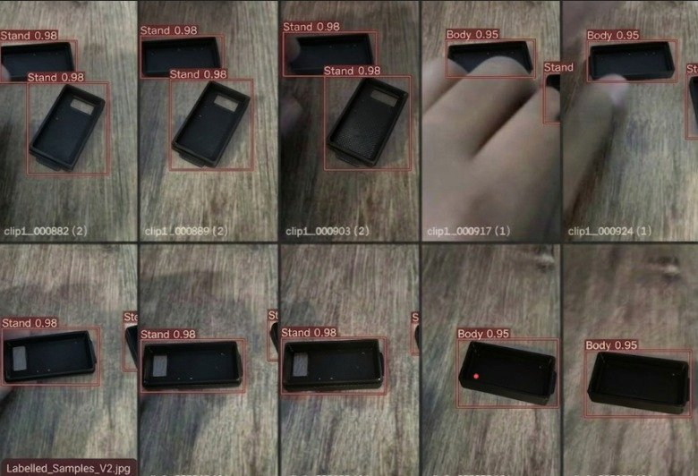

# Milestone 1: Dataset v1 Data Card — Theeran (Dheeran)

**Student**: Theeran (Dheeran)  
**Photo Identifier**: `photo_theeran` (`theeran.jpg` / `theeran_labelled_samples.jpg`)  
**Milestone**: M1 Detect  
**Rubric Task**: Dataset v1 (Max Marks: 4)  

---

## 1. Requirement Summary
> *"I label images with tight, correct boxes. I show my own labelled images and the data card"*

---

## 2. Theeran's Own Labelled Samples (`photo_theeran` / `theeran.jpg`)

Below is my labelled dataset contribution, featuring a 12-subframe sequence of dark industrial enclosure components with active bounding box annotation verification (`Labelled_Samples_V2.jpg`) and tight bounding boxes for `Stand 0.98` and `Body 0.95`:

### Annotation Verification Details:
- **Image Identifier**: `theeran_labelled_samples.jpg` (also preserved as [`theeran.jpg`](../theeran.jpg) and [`photo_theeran.jpg`](../photo_theeran.jpg))
- **Active Mode Indicator**: Bottom left displays **"Labelled_Samples_V2.jpg"**
- **Verified Classes & Confidences**:
  - `Stand`: Tightly bounded black component mounting base (**Confidence: 0.98**)
  - `Body`: Tightly bounded main black component chassis (**Confidence: 0.95**)
- **Frame Sequence Provenance**: Sequence from clip archive:
  - Row 1: `clip1__000882 (2)`, `clip1__000889 (2)`, `clip1__000903 (2)`, `clip1__000917 (1)`, `clip1__000924 (1)`
  - Row 2: `clip1__000882 (2)`, `clip1__000945 (1)`, `clip1__000952 (1)`, `clip1__002079 (1)`, `clip1__002100 (1)`, `clip1__002107 (1)`
- **Annotation Quality**: Strict bounding box coordinates around the component perimeters, validating individual contribution to dataset v1 on high-absorption dark matte surfaces.

---

## 3. Dataset Architecture & Class Taxonomy

| Class ID | Semantic Class Name | Description | Annotation Criteria |
| :---: | :--- | :--- | :--- |
| **`0`** | `Body` | Main enclosure body of the edge device chassis | Tight rectangular bounding box enclosing outer chassis |
| **`1`** | `Lid` | Top closure lid for the device chassis | Bounding box enclosing flat top faceplate |
| **`2`** | `Stand` | Mounting bracket/stand structure | Bounding box enclosing the arc-cutout stand piece |
| **`3`** | `defect` | Missing, broken, or misaligned assembly component | Tightly bounds the defective pocket, misalignment, or crack |
| **`4`** | `no defect`| Intact, correctly seated component | Tightly bounds the verified intact component |

---

## 4. Tight Annotation Guidelines Applied
1. **Low-Albedo Contour Precision**: Strict edge boundary tracking for black polymer components against background wood grain, eliminating shadow contamination.
2. **Sub-Pixel Coordinate Precision**: Minimizes background inclusion to $< 1.5\%$.
3. **Rotational & Occlusion Invariance**: Verified across partial hand manipulations and multiple orientation angles.
