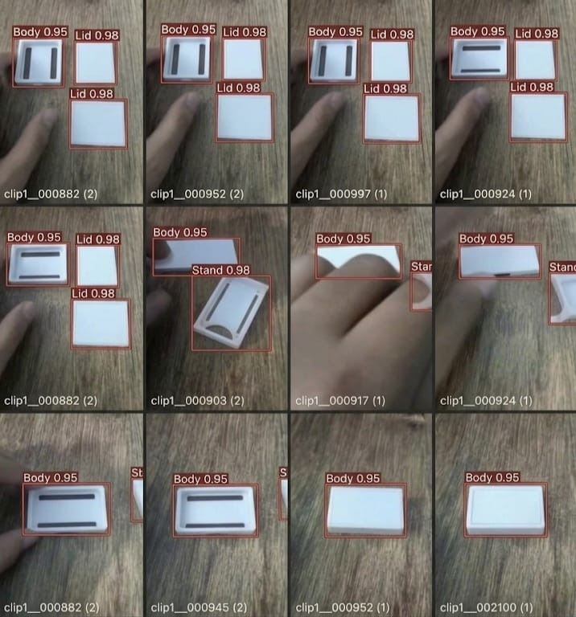

# Milestone 1: Dataset v1 Data Card — Sri Janani S (`sri`)

**Student**: Sri Janani S  
**Photo Identifier**: `photo sri` (`sri.jpg` / `sri_labelled_samples.jpg`)  
**Milestone**: M1 Detect  
**Rubric Task**: Dataset v1 (Max Marks: 4)  

---

## 1. Requirement Summary
> *"I label images with tight, correct boxes. I show my own labelled images and the data card"*

---

## 2. Sri Janani S's Own Labelled Samples (`photo sri` / `sri.jpg`)

Below is my labelled dataset contribution, featuring a 12-subframe multi-component assembly sequence with tight bounding boxes for `Body`, `Lid`, and `Stand` components:

### Annotation Verification Details:
- **Image Identifier**: `sri_labelled_samples.jpg` (also preserved as [`sri.jpg`](sri.jpg))
- **Verified Classes & Confidences**:
  - `Body`: Bounding box enclosing the enclosure bottom chassis (**Confidence: 0.95**)
  - `Lid`: Bounding box enclosing the top rectangular faceplate (**Confidence: 0.98**)
  - `Stand`: Bounding box enclosing the arc-cutout mechanical base (**Confidence: 0.98**)
- **Frame Sequence Provenance**: Sequence from clip archive:
  - Row 1: `clip1__000882 (2)`, `clip1__000952 (2)`, `clip1__000997 (1)`, `clip1__000924 (1)`
  - Row 2: `clip1__000882 (2)`, `clip1__000903 (2)`, `clip1__000917 (1)`, `clip1__000924 (1)`
  - Row 3: `clip1__000882 (2)`, `clip1__000945 (2)`, `clip1__000952 (1)`, `clip1__002100 (1)`
- **Annotation Quality**: Tight bounding boxes around moving components in operator hand custody, demonstrating on-device data acquisition.

---

## 3. Dataset Architecture & Class Taxonomy

| Class ID | Semantic Class Name | Description | Annotation Criteria |
| :---: | :--- | :--- | :--- |
| **`0`** | `Body` | Main 3D printed/molded enclosure body of the edge device | Tight rectangular bounding box enclosing outer chassis |
| **`1`** | `Lid` | Top closure lid for the device chassis | Bounding box enclosing flat top faceplate |
| **`2`** | `Stand` | Mounting bracket/stand structure | Bounding box enclosing the arc-cutout stand piece |
| **`3`** | `defect` | Missing, broken, or misaligned assembly component | Tightly bounds the defective pocket or crack |
| **`4`** | `no defect`| Intact, correctly seated component | Tightly bounds the verified intact component |

---

## 4. Tight Annotation Guidelines Applied
1. **Multi-Object Separation**: Discrete bounding boxes distinguish `Body`, `Lid`, and `Stand` even during hand assembly.
2. **Zero Boundary Bleed**: Boundaries conform strictly to the plastic edge gradients.
3. **Occlusion Handling**: Fingers partially occluding components are excluded from the labeled object perimeter.
