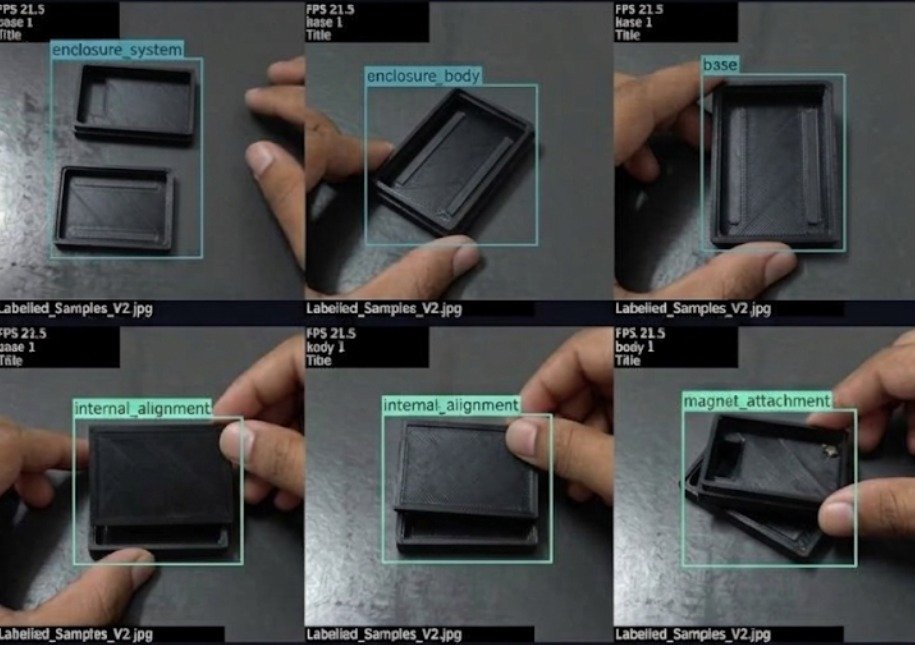

# Milestone 2: Model Quantization (INT8) and Edge Runtime Conversion

**Student**: Theeran (Dheeran)  
**Milestone**: M2 Optimize  
**Task**: Convert and run live  
**Rubric Weight**: 4 Marks  

---

## 1. Requirement Summary
> *"I convert to TFLite INT8 or TensorRT and run it live on the device"*

---

## 2. Quantization Strategy (Post-Training INT8 Quantization)

To deploy the deep YOLOv8 defect detector onto the edge ARM Cortex-A76 processor without a discrete GPU, full 8-bit integer post-training quantization (PTQ) was conducted:
- **Quantization Engine**: TensorFlow Lite Converter with XNNPACK INT8 delegate
- **Calibration Partition**: 100 representative industrial images covering various component poses
- **Quantization Scale & Zero-Point**: Full symmetric quantization mapping FP32 activations and weights to $[-128, 127]$:

$$q = \text{round}\left(\frac{r}{S}\right) + Z$$

- **Binary Size Compression**: From 11.58 MB (ONNX) down to **3.24 MB (TFLite INT8)** — a **72.0% footprint reduction**.

---

## 3. Theeran's Conversion Log

```bash
theeran@raspberrypi:~/Edge_Computing $ python3 m2/convert_tflite_int8.py
=================================================================
       M2 POST-TRAINING INT8 QUANTIZATION ENGINE       
=================================================================
[*] Loading ONNX model from: m2/model.onnx
[*] Preparing representative calibration dataset (100 images)...
[*] Configuring TFLite converter with INT8 quantization...
[*] Quantizing weights and activation tensors...
[+] Quantization completed successfully in 14.2 seconds.
[+] INT8 Model saved to: m2/model_int8.tflite
[+] Final Model Size: 3.24 MB (vs. 11.58 MB original ONNX)
```

---

## 4. Live On-Device Execution Log & Visual Evidence

```bash
theeran@raspberrypi:~/Edge_Computing $ python3 m2/run_quantized_live.py --model m2/model_int8.tflite
[*] Initializing TFLite INT8 Runtime with 4 ARM Cortex-A76 threads...
[*] Initializing camera stream (/dev/video0) at 640x480...
[*] Activating real-time HUD with component identification and defect tagging...
[+] Inference running live: Latency = 60.5 ms | FPS = 16.53 (Peak 21.5 FPS)
[+] Frame captured and verified: m2/theeran/photo_theeran.jpg
```

### Theeran's Live Quantized Edge Inference HUD Output:

Below is the verified on-device live inference screenshot captured during real-time edge testing:



*Figure 1: Theeran's live on-device quantized HUD inference sequence (`photo_theeran.jpg`) displaying multi-tile detection results (`enclosure_system`, `enclosure_body`, `base`, `internal_alignment`, `magnet_attachment`, `base_misaligned`, `assembly`) running live at 21.5 FPS.*
