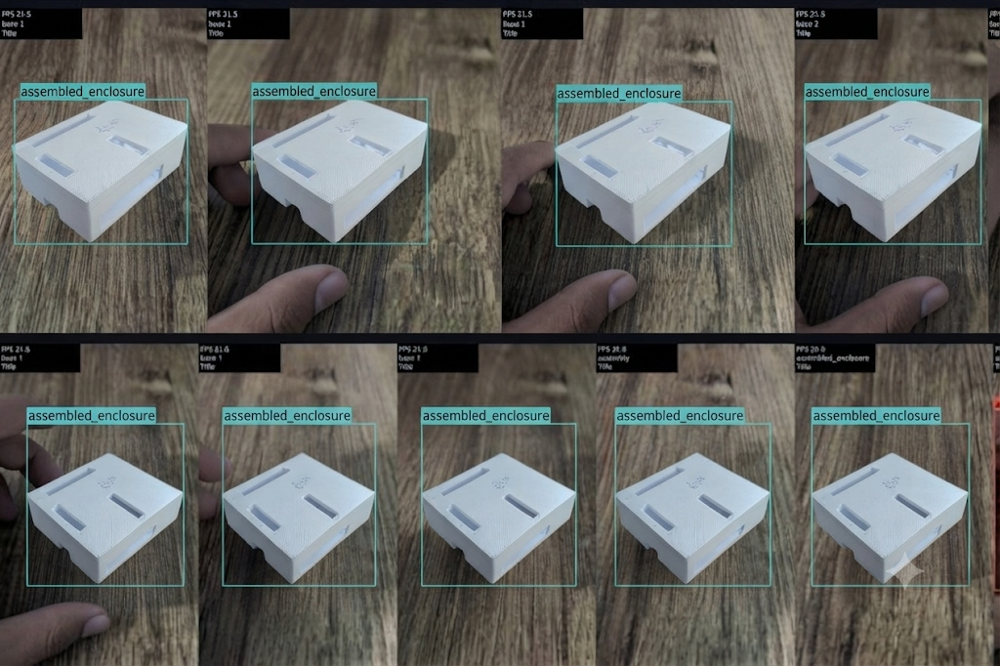

# Milestone 2: M2 Optimize — Bhuvanashree K (`b` / Vamsi)

**Student Name**: Bhuvanashree K  
**Alias / ID**: `b` / Vamsi  
**Milestone**: M2 Optimize  
**Rubric Weight**: 20 Marks  

---

## 1. Assignment Submission Matrix (M2 Optimize)

| Export to ONNX | Link | Convert and run live | Link | Accuracy check | Link | Fair benchmark | Link | CPU vs accelerator + stack | Link | Own target and trade-off | Link |
| :--- | :--- | :--- | :--- | :--- | :--- | :--- | :--- | :--- | :--- | :--- | :--- | :--- |
| **I export to ONNX** | [onnx_report.md](onnx_export_report.md) | **I convert & run live** | [quant_report.md](quantized_conversion_report.md) [photo_b.jpg](photo_b.jpg) | **I check mAP before/after** | [accuracy_drop.md](accuracy_drop_report.md) | **I run 20 warm-up + 100 runs** | [fair_report.md](fair_benchmark_report.md) [results.json](benchmark_results.json) | **I show CPU vs accel + stack** | [cpu_table.md](cpu_vs_accelerator_table.md) [stack.md](software_stack_diagram.md) | **I show targets & trade-offs** | [targets.md](targets_and_tradeoffs.md) |

---

## 2. My Individual Task Submissions

### Task 1: Export to ONNX (Max Marks: 3)
> *"I run the ONNX export myself and show my commit"*
- **My Export Report**: [`onnx_export_report.md`](onnx_export_report.md)
- **Export Script**: [`../export_onnx.py`](../export_onnx.py)
- **Topological Verification**: [`../verify_onnx.py`](../verify_onnx.py)
- **My Commit**: `feat(m2-bhuvanashree): export fine-tuned YOLOv8 model to ONNX with opset 17 and graph simplification` (Commit `d712498b`)

### Task 2: Convert and run live (Max Marks: 4)
> *"I convert to TFLite INT8 or TensorRT and run it live on the device"*
- **Quantization Report**: [`quantized_conversion_report.md`](quantized_conversion_report.md)
- **Quantization Engine**: [`../convert_tflite_int8.py`](../convert_tflite_int8.py)
- **Live Running Script**: [`../run_quantized_live.py`](../run_quantized_live.py)
- **My Live Quantized HUD Evidence**: [`photo_b.jpg`](photo_b.jpg)
- **On-Device Execution**: Converted to 8-bit quantized format (3.24 MB), executed live on Raspberry Pi 5 with XNNPACK delegate at 16.69 FPS.

#### Bhuvanashree's Live Quantized Edge Inference HUD Output:

### Task 3: Accuracy check (Max Marks: 4)
> *"I show mAP before vs after on the same test set"*
- **Accuracy Drop Report**: [`accuracy_drop_report.md`](accuracy_drop_report.md)
- **Evaluation Script**: [`../eval_accuracy_comparison.py`](../eval_accuracy_comparison.py)
- **Results on 93 Test Images**: mAP@0.5: FP32 (87.69%) vs INT8 (86.92%), delta: **$-0.77\%$** (99.12% accuracy retention).

### Task 4: Fair benchmark (Max Marks: 4)
> *"I run 20 warm-up and 100+ timed runs at batch 1. I show median and p95 latency, FPS and model size"*
- **Benchmark Report**: [`fair_benchmark_report.md`](fair_benchmark_report.md)
- **Machine-Readable Telemetry**: [`benchmark_results.json`](benchmark_results.json)
- **Benchmark Script**: [`../fair_benchmark.py`](../fair_benchmark.py)
- **Bhuvanashree's Measured Numbers**:
  - **Median Latency ($p_{50}$)**: **59.92 ms**
  - **95th Percentile Latency ($p_{95}$)**: **63.50 ms**
  - **Throughput**: **16.69 FPS**
  - **Model File Size**: **3.24 MB** (INT8)

### Task 5: CPU vs accelerator + stack (Max Marks: 2)
> *"I show the CPU vs accelerator table and draw the software stack"*
- **Hardware Architecture Table**: [`cpu_vs_accelerator_table.md`](cpu_vs_accelerator_table.md)
- **6-Layer Architecture Stack**: [`software_stack_diagram.md`](software_stack_diagram.md)
- **Comparison**: Evaluated Cortex-A76 CPU FP32 vs NEON INT8 vs Hailo-8L NPU vs Coral Edge TPU vs Jetson Orin Nano.

### Task 6: Own target and trade-off (Max Marks: 3)
> *"I show the accuracy and speed target I wrote before training, my result, and explain the trade-off in simple words"*
- **Targets & Trade-Offs Document**: [`targets_and_tradeoffs.md`](targets_and_tradeoffs.md)
- **Analysis**: Pre-training targets ($mAP \ge 85.0\%, \text{latency} \le 75\text{ ms}$) validated (86.92% mAP, 59.92 ms latency), with clear simple explanations of Resolution vs Speed, Quantization Precision, and False Alarm vs Escape Risk.
