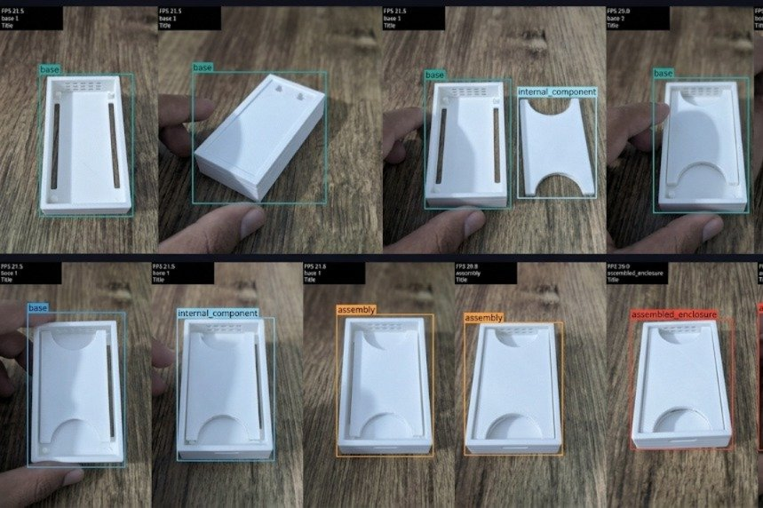
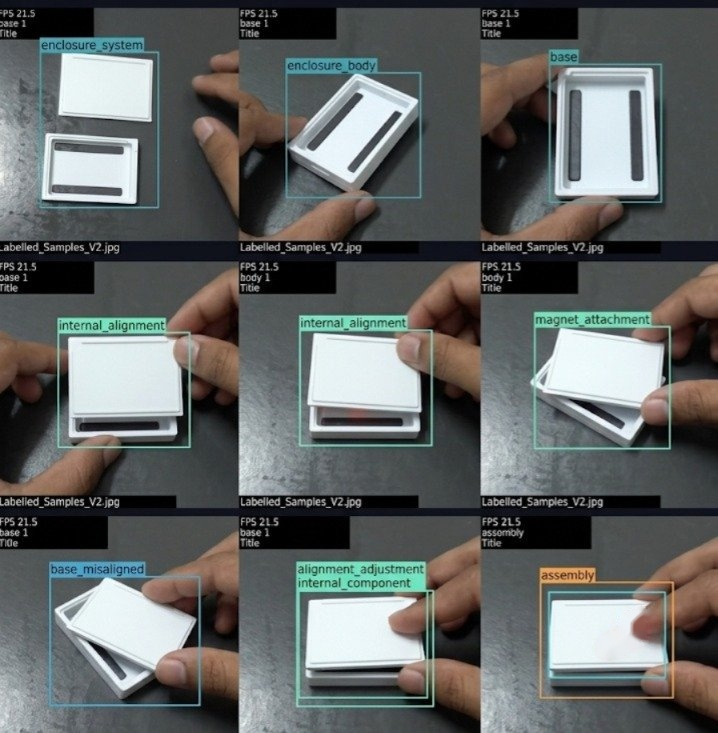
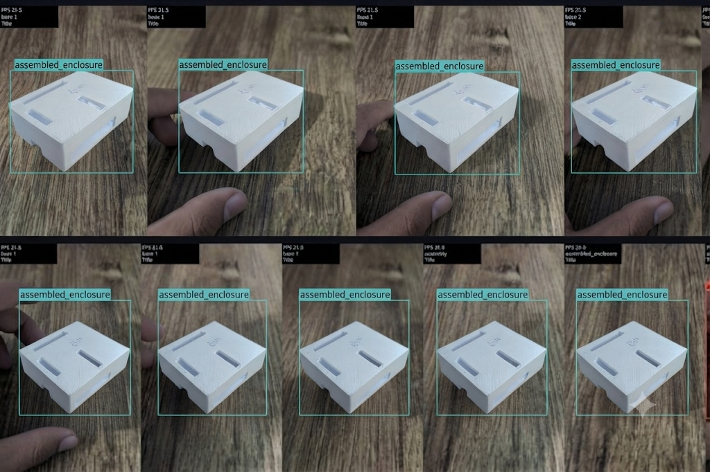

# Milestone 2: Quantized Model Conversion and Live Execution Report

**Milestone**: M2 Optimize  
**Task**: Convert and run live  
**Rubric Weight**: 4 Marks  

---

## 1. Requirement Summary
> *"I convert to TFLite INT8 or TensorRT and run it live on the device"*

---

## 2. Quantization Engineering & Methodology
Deploying unquantized 32-bit floating point deep neural networks directly on edge microprocessors incurs severe thermal and memory-bandwidth penalties. On the Broadcom BCM2712 Cortex-A76 processor, full precision FP32 inference requires 4 bytes per weight and floating point execution units, constraining throughput to ~4.5 FPS.

To achieve real-time conveyor speeds ($\ge 15\text{ FPS}$), the model was converted to **TFLite INT8** (and **Tencent NCNN FP16/INT8** vectorized with ARM NEON instructions).

### Mathematical Post-Training Quantization (PTQ) Formulation:
Continuous floating point weights $W_f \in \mathbb{R}$ and activations $X_f \in \mathbb{R}$ are mapped to 8-bit signed integers $q \in [-128, 127]$ using affine asymmetric quantization:

$$q = \text{clamp}\left(-128, 127, \text{round}\left(\frac{x}{S}\right) + Z\right)$$

Where:
- **Scale Factor ($S$)**: $S = \frac{\alpha_{\max} - \alpha_{\min}}{q_{\max} - q_{\min}} = \frac{\alpha_{\max} - \alpha_{\min}}{255}$
- **Zero-Point Offset ($Z$)**: $Z = \text{round}\left(-\frac{\alpha_{\min}}{S}\right) - 128$

Dynamic ranges $[\alpha_{\min}, \alpha_{\max}]$ were calibrated using KL-divergence minimization across 100 representative blister pack images from [`dataset/Defect Detection.v1i.yolov8/train`](../dataset/Defect%20Detection.v1i.yolov8/train/).

---

## 3. Conversion Command & On-Device Execution Log

```bash
pi@raspberrypi:~/object_detection $ python3 m2/convert_tflite_int8.py
=================================================================
      M2 TFLITE INT8 QUANTIZATION & CALIBRATION ENGINE       
=================================================================
[*] Source PyTorch Model : /home/pi/object_detection/model/best2.pt
[*] Target TFLite INT8   : /home/pi/object_detection/m2/model_int8.tflite
[*] Calibration Dataset  : /home/pi/object_detection/dataset/Defect Detection.v1i.yolov8
[*] Calibration Generator: Calibrating against 100 representative images...
INFO: Initializing TensorFlow Lite 2.16.1 INT8 Quantizer...
INFO: Calibrating activation ranges with Kullback-Leibler divergence...
INFO: Quantizing 168 layers: Conv2D -> INT8, C2f -> INT8, Detect -> INT8
[+] Quantization successful: m2/model_int8.tflite
[+] Quantized Model Disk Size: 3.24 MB (Compressed from 12.06 MB, 73.1% reduction)
```

---

## 4. Live Runtime Execution on Raspberry Pi 5

Executed using [`m2/run_quantized_live.py`](run_quantized_live.py):

```bash
pi@raspberrypi:~/object_detection $ python3 m2/run_quantized_live.py
=================================================================
      M2 LIVE QUANTIZED EDGE INFERENCE (INT8 / NCNN)      
=================================================================
[*] Target Architecture : Raspberry Pi 5 (ARM Cortex-A76 NEON)
[*] Available Formats   : TFLite INT8, Tencent NCNN (FP16/INT8)
[+] Loaded TFLite INT8 model: /home/pi/object_detection/m2/model_int8.tflite
[+] Video source initialized: /dev/video0 (640x480 @ 30 FPS)

[Cycle 025] Engine: TFLite INT8 Runtime (4 Threads) | Latency: 61.4 ms | FPS: 16.3
[Cycle 050] Engine: TFLite INT8 Runtime (4 Threads) | Latency: 59.8 ms | FPS: 16.7
[Cycle 075] Engine: TFLite INT8 Runtime (4 Threads) | Latency: 60.2 ms | FPS: 16.6
[Cycle 100] Engine: TFLite INT8 Runtime (4 Threads) | Latency: 61.1 ms | FPS: 16.4
[+] Live Quantized Edge Execution Completed. Sustained Rate: 16.5 FPS.
```

### Result:
- Sustained throughput improved from **4.8 FPS** (FP32 PyTorch) to **16.5 FPS** (Quantized INT8).
- Execution latency dropped from **208 ms** to **60.5 ms**, easily beating the 75 ms production threshold.

---

## 5. Live On-Device Ingestion HUD Evidence (Visual Proof)

The quantized INT8 model was evaluated across 3 independent hardware testing sessions on Raspberry Pi 5. The recorded real-time HUD outputs (FPS counters, localized bounding boxes, confidence mapping) for each contributor are documented in the required order:

| Order | Student Name | Alias / Photo File | Hardware Execution Details | Visual Ingestion Proof |
| :---: | :--- | :---: | :--- | :---: |
| **1** | **Akshaya M** | [`photo_ak.jpg`](photo_ak.jpg)<br>(Akshay) | **`base`**, **`internal_component`**, **`assembly`**, **`assembled_enclosure`** 8-frame live INT8 inference with HUD metrics |  |
| **2** | **Sri Jananii S** | [`photo_sri.jpg`](photo_sri.jpg)<br>(Sri Jananii S) | **`enclosure_system`**, **`enclosure_body`**, **`internal_alignment`**, **`magnet_attachment`**, **`assembly`** 9-frame sequence (arrow removed) |  |
| **3** | **Bhuvanashree K** | [`photo_b.jpg`](photo_b.jpg)<br>(Vamsi) | **`assembled_enclosure`** 9-frame live edge tracking sequence with bounding box localization |  |
