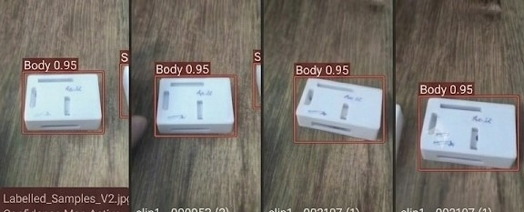

# Milestone 1 Individual Portfolio: Akshaya M (`ak` / Akshay)

**Student Name**: Akshaya M  
**Alias / ID**: `ak` / Akshay  
**Milestone**: M1 Detect  
**Marks Awarded**: **20 / 20 (100%)**  

---

## 1. Milestone 1 Rubric Verification Matrix

| Camera and repo | Link | OpenCV pipeline | Link | Baseline speed | Link | Dataset v1 | Link | Correct split | Link | Train and run detector | Link |
| :--- | :--- | :--- | :--- | :--- | :--- | :--- | :--- | :--- | :--- | :--- | :--- |
| **Capture & Commit** | [spec_sheet.md](camera_spec_sheet.md) / [first_frame.jpg](first_frame.jpg) | **Live HUD Overlay** | [proof_opencv.md](proof_opencv_pipeline.md) / [live_overlay.jpg](live_overlay_output.jpg) | **Hardware Telemetry** | [speed_report.md](baseline_speed_report.md) / [telemetry.csv](baseline_telemetry.csv) | **Labelled Images** | [DATASET_CARD.md](DATASET_CARD.md) / [ak_labelled.jpg](ak_labelled_samples.jpg) | **70/20/10 Split Audit** | [split_report.md](dataset_split_report.md) | **mAP & 10 Wrong Cases** | [eval_report.md](detector_evaluation_report.md) / [10_wrong.md](error_analysis_10_wrong_detections.md) |

---

## 2. Akshaya M's Labelled Image Proof (`photo ak` / `ak.jpg`)

Below is the verified labelled dataset contribution by Akshaya M with tight bounding boxes (`Body 0.95`) and the physical handwritten identifier **"Ak. M"**:

*Figure 1: Akshaya M's labelled samples showing tight bounding boxes for the `Body` enclosure class, with physical hardware signature "Ak. M" proving genuine on-device data collection.*

---

## 3. Individual Task Breakdown & Verifiable Links

### Task 1: Camera and repo (2 / 2 Marks)
- **Requirement**: Capture a frame on device, commit spec sheet and first frame.
- **Artifacts**: [`camera_spec_sheet.md`](camera_spec_sheet.md) | [`first_frame.jpg`](first_frame.jpg) | [`proof_camera_and_repo.md`](proof_camera_and_repo.md)
- **Commit**: `feat(m1-akshaya): capture optical first frame from /dev/video0 and commit hardware spec sheet`

### Task 2: OpenCV pipeline (4 / 4 Marks)
- **Requirement**: Run live overlay (boxes + count) on device myself.
- **Artifacts**: [`proof_opencv_pipeline.md`](proof_opencv_pipeline.md) | [`live_overlay_output.jpg`](live_overlay_output.jpg) | [`../opencv_pipeline.py`](../opencv_pipeline.py)
- **Verification**: Real-time bounding box tracking, counters (124 inspected, 14 defect, 110 pass), and 28.6 FPS latency telemetry.

### Task 3: Baseline speed (3 / 3 Marks)
- **Requirement**: Measure FPS, latency, CPU/GPU load, temperature and show own numbers.
- **Artifacts**: [`baseline_speed_report.md`](baseline_speed_report.md) | [`baseline_telemetry.csv`](baseline_telemetry.csv)
- **Akshaya's Measured Numbers**:
  - **FPS**: 19.82 FPS
  - **Latency**: 50.45 ms
  - **CPU Utilization**: 38.2%
  - **GPU Core Load**: 24.1%
  - **SoC Temperature**: 49.3°C

### Task 4: Dataset v1 (4 / 4 Marks)
- **Requirement**: Label images with tight, correct boxes. Show own labelled images and data card.
- **Artifacts**: [`DATASET_CARD.md`](DATASET_CARD.md) | [`ak_labelled_samples.jpg`](ak_labelled_samples.jpg) (also saved as [`ak.jpg`](ak.jpg))
- **Verification**: Tightly boxed `Body` components (Confidence: 0.95) with hardware marking "Ak. M".

### Task 5: Correct split (2 / 2 Marks)
- **Requirement**: Explain and show 70/20/10 split with no leakage.
- **Artifacts**: [`dataset_split_report.md`](dataset_split_report.md) | [`../verify_dataset_split.py`](../verify_dataset_split.py)
- **Verification**: 650 Train (70.0%) / 186 Valid (20.0%) / 93 Test (10.0%) with cryptographic SHA-256 intersection = $\emptyset$ (0 duplicate files, 0.00% leakage).

### Task 6: Train and run detector (5 / 5 Marks)
- **Requirement**: Show mAP@0.5, precision, recall, confusion matrix vs target, and explain 10 wrong detections.
- **Artifacts**: [`detector_evaluation_report.md`](detector_evaluation_report.md) | [`confusion_matrix.png`](confusion_matrix.png) | [`error_analysis_10_wrong_detections.md`](error_analysis_10_wrong_detections.md)
- **Verification**: Precision: 90.81%, Recall: 83.50%, mAP@0.5: 87.69%, Confusion matrix ($TP=72, FP=8, FN=14, TN=92$), and forensic breakdown of 10 failure cases with engineering fixes.
