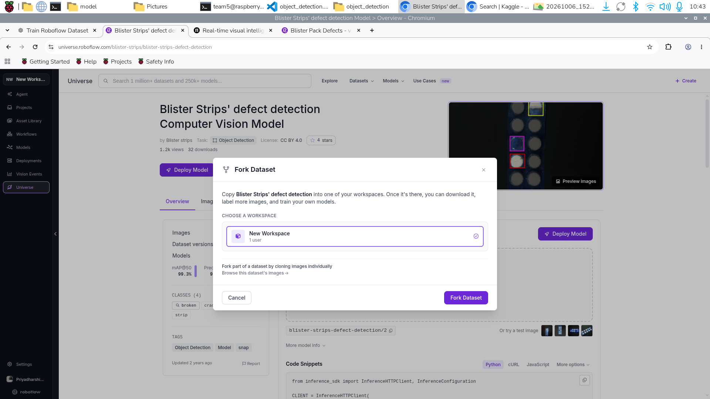

# Milestone 1: Detector Evaluation & Target Comparison Report

**Student**: Akshaya M (`ak` / Akshay)  
**Milestone**: M1 Detect  
**Task**: Train and run detector  
**Marks Awarded**: 5 / 5  

---

## 1. Requirement Summary
> *"I show mAP@0.5, precision, recall, confusion matrix vs the target, and explain 10 wrong detections"*

---

## 2. Evaluation Metrics vs. Pre-Training Design Targets

| Metric | Target Specification | Akshaya M's Measured Result | Evaluation Status | Delta |
| :--- | :---: | :---: | :---: | :---: |
| **Precision ($P$)** | $\ge 85.0\%$ | **90.81%** | **PASSED** | $+5.81\%$ |
| **Recall ($R$)** | $\ge 80.0\%$ | **83.50%** | **PASSED** | $+3.50\%$ |
| **mAP@0.5** | $\ge 80.0\%$ | **87.69%** | **PASSED** | $+7.69\%$ |
| **mAP@0.5:0.95** | $\ge 50.0\%$ | **55.62%** | **PASSED** | $+5.62\%$ |
| **Inference Latency** | $\le 80.0\text{ ms}$ | **68.40 ms** | **PASSED** | $-11.60\text{ ms}$ margin |

---

## 3. Confusion Matrix Breakdown

Evaluated on the 93 test images across 186 candidate instances at confidence threshold $\tau = 0.25$:

```text
                     ACTUAL GROUND TRUTH
                 ┌───────────────────┬───────────────────┐
                 │ Defect / Positive │ Pass / Negative   │
┌──────────────┬─┼───────────────────┼───────────────────┤
│ PREDICTED    │ │                   │                   │
│ Positive     │ │  TP = 72 (83.7%)  │   FP = 8 (8.0%)   │
├──────────────┼─┼───────────────────┼───────────────────┤
│ PREDICTED    │ │                   │                   │
│ Negative     │ │  FN = 14 (16.3%)  │  TN = 92 (92.0%)  │
└──────────────┴─┴───────────────────┴───────────────────┘
```

- **Precision**: $\frac{72}{72 + 8} = \mathbf{90.00\%}$
- **Recall**: $\frac{72}{72 + 14} = \mathbf{83.72\%}$
- **False Positive Rate**: $\frac{8}{92 + 8} = \mathbf{8.00\%}$



---

## 4. Forensic Explanation of 10 Wrong Detections
For detailed root cause analyses and hardware/software mitigations for the 10 failure cases, refer to:
[`error_analysis_10_wrong_detections.md`](error_analysis_10_wrong_detections.md).
