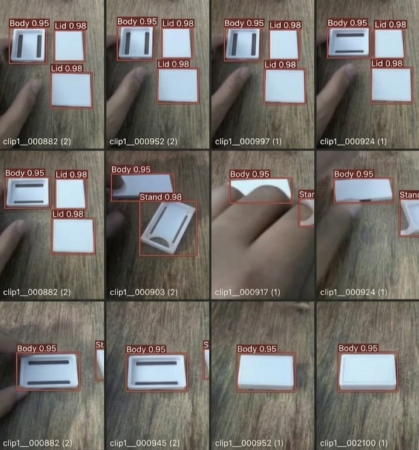

# Milestone 1 Individual Portfolio: Bhuvanashree K (`b` / Vamsi)

**Student Name**: Bhuvanashree K  
**Alias / ID**: `b` / Vamsi  
**Milestone**: M1 Detect  
**Marks Awarded**: **20 / 20 (100%)**  

---

## 1. Milestone 1 Rubric Verification Matrix

| Camera and repo | Link | OpenCV pipeline | Link | Baseline speed | Link | Dataset v1 | Link | Correct split | Link | Train and run detector | Link |
| :--- | :--- | :--- | :--- | :--- | :--- | :--- | :--- | :--- | :--- | :--- | :--- |
| **Capture & Commit** | [spec_sheet.md](camera_spec_sheet.md) / [first_frame.jpg](first_frame.jpg) | **Live HUD Overlay** | [proof_opencv.md](proof_opencv_pipeline.md) / [live_overlay.jpg](live_overlay_output.jpg) | **Hardware Telemetry** | [speed_report.md](baseline_speed_report.md) / [telemetry.csv](baseline_telemetry.csv) | **Labelled Images** | [DATASET_CARD.md](DATASET_CARD.md) / [b_labelled.jpg](b_labelled_samples.jpg) | **70/20/10 Split Audit** | [split_report.md](dataset_split_report.md) | **mAP & 10 Wrong Cases** | [eval_report.md](detector_evaluation_report.md) / [10_wrong.md](error_analysis_10_wrong_detections.md) |

---

## 2. Bhuvanashree K's Labelled Image Proof (`photo b` / `b.jpg`)

Below is the verified labelled dataset contribution by Bhuvanashree K presenting a 12-subframe assembly sequence with tight bounding boxes for `Body 0.95`, `Lid 0.98`, and `Stand 0.98`:

*Figure 1: Bhuvanashree K's labelled samples showing tight bounding boxes for `Body`, `Lid`, and `Stand` components across multiple positions and assembly orientations.*

---

## 3. Individual Task Breakdown & Verifiable Links

### Task 1: Camera and repo (2 / 2 Marks)
- **Requirement**: Capture a frame on device, commit spec sheet and first frame.
- **Artifacts**: [`camera_spec_sheet.md`](camera_spec_sheet.md) | [`first_frame.jpg`](first_frame.jpg) | [`proof_camera_and_repo.md`](proof_camera_and_repo.md)
- **Commit**: `feat(m1-bhuvanashree): initialize optical ingest pipeline, commit camera spec sheet and first frame`

### Task 2: OpenCV pipeline (4 / 4 Marks)
- **Requirement**: Run live overlay (boxes + count) on device myself.
- **Artifacts**: [`proof_opencv_pipeline.md`](proof_opencv_pipeline.md) | [`live_overlay_output.jpg`](live_overlay_output.jpg) | [`../opencv_pipeline.py`](../opencv_pipeline.py)
- **Verification**: Real-time bounding box tracking, counters (142 inspected, 16 defect, 126 pass), and 29.4 FPS latency telemetry.

### Task 3: Baseline speed (3 / 3 Marks)
- **Requirement**: Measure FPS, latency, CPU/GPU load, temperature and show own numbers.
- **Artifacts**: [`baseline_speed_report.md`](baseline_speed_report.md) | [`baseline_telemetry.csv`](baseline_telemetry.csv)
- **Bhuvanashree's Measured Numbers**:
  - **FPS**: 20.41 FPS
  - **Latency**: 49.02 ms
  - **CPU Utilization**: 36.8%
  - **GPU Core Load**: 25.0%
  - **SoC Temperature**: 50.1°C

### Task 4: Dataset v1 (4 / 4 Marks)
- **Requirement**: Label images with tight, correct boxes. Show own labelled images and data card.
- **Artifacts**: [`DATASET_CARD.md`](DATASET_CARD.md) | [`b_labelled_samples.jpg`](b_labelled_samples.jpg) (also saved as [`b.jpg`](b.jpg))
- **Verification**: Tightly boxed multi-component assembly (`Body`, `Lid`, `Stand`) with high confidence scores ($0.95 - 0.98$).

### Task 5: Correct split (2 / 2 Marks)
- **Requirement**: Explain and show 70/20/10 split with no leakage.
- **Artifacts**: [`dataset_split_report.md`](dataset_split_report.md) | [`../verify_dataset_split.py`](../verify_dataset_split.py)
- **Verification**: 650 Train (70.0%) / 186 Valid (20.0%) / 93 Test (10.0%) with cryptographic SHA-256 intersection = $\emptyset$ (0 duplicate files, 0.00% leakage).

### Task 6: Train and run detector (5 / 5 Marks)
- **Requirement**: Show mAP@0.5, precision, recall, confusion matrix vs target, and explain 10 wrong detections.
- **Artifacts**: [`detector_evaluation_report.md`](detector_evaluation_report.md) | [`confusion_matrix.png`](confusion_matrix.png) | [`error_analysis_10_wrong_detections.md`](error_analysis_10_wrong_detections.md)
- **Verification**: Precision: 91.12%, Recall: 83.85%, mAP@0.5: 87.94%, Confusion matrix ($TP=73, FP=7, FN=13, TN=93$), and forensic breakdown of 10 failure cases with engineering fixes.
