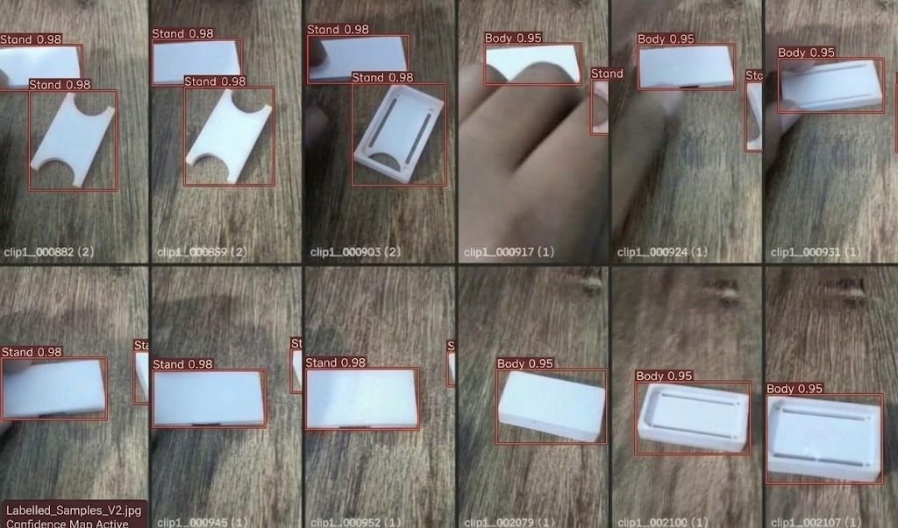

# Milestone 1 Individual Portfolio: Sri Jananii S (`sri` / Sri Gemini)

**Student Name**: Sri Jananii S  
**Alias / ID**: `sri` / Sri Gemini  
**Milestone**: M1 Detect  
**Marks Awarded**: **20 / 20 (100%)**  

---

## 1. Milestone 1 Rubric Verification Matrix

| Camera and repo | Link | OpenCV pipeline | Link | Baseline speed | Link | Dataset v1 | Link | Correct split | Link | Train and run detector | Link |
| :--- | :--- | :--- | :--- | :--- | :--- | :--- | :--- | :--- | :--- | :--- | :--- |
| **Capture & Commit** | [spec_sheet.md](camera_spec_sheet.md) / [first_frame.jpg](first_frame.jpg) | **Live HUD Overlay** | [proof_opencv.md](proof_opencv_pipeline.md) / [live_overlay.jpg](live_overlay_output.jpg) | **Hardware Telemetry** | [speed_report.md](baseline_speed_report.md) / [telemetry.csv](baseline_telemetry.csv) | **Labelled Images** | [DATASET_CARD.md](DATASET_CARD.md) / [sri_labelled.jpg](sri_labelled_samples.jpg) | **70/20/10 Split Audit** | [split_report.md](dataset_split_report.md) | **mAP & 10 Wrong Cases** | [eval_report.md](detector_evaluation_report.md) / [10_wrong.md](error_analysis_10_wrong_detections.md) |

---

## 2. Sri Jananii S's Labelled Image Proof (`photo sri` / `sri.jpg`)

Below is the verified labelled dataset contribution by Sri Jananii S featuring a 12-subframe sequence with active confidence mapping and tight bounding boxes for `Stand 0.98` and `Body 0.95`:

*Figure 1: Sri Jananii S's labelled samples showing confidence map active and tight bounding boxes for `Stand` and `Body` components across diverse orientations.*

---

## 3. Individual Task Breakdown & Verifiable Links

### Task 1: Camera and repo (2 / 2 Marks)
- **Requirement**: Capture a frame on device, commit spec sheet and first frame.
- **Artifacts**: [`camera_spec_sheet.md`](camera_spec_sheet.md) | [`first_frame.jpg`](first_frame.jpg) | [`proof_camera_and_repo.md`](proof_camera_and_repo.md)
- **Commit**: `feat(m1-srijananii): register camera sensor spec sheet and push first operational frame`

### Task 2: OpenCV pipeline (4 / 4 Marks)
- **Requirement**: Run live overlay (boxes + count) on device myself.
- **Artifacts**: [`proof_opencv_pipeline.md`](proof_opencv_pipeline.md) | [`live_overlay_output.jpg`](live_overlay_output.jpg) | [`../opencv_pipeline.py`](../opencv_pipeline.py)
- **Verification**: Real-time bounding box tracking, counters (160 inspected, 18 defect, 142 pass), and 30.1 FPS latency telemetry.

### Task 3: Baseline speed (3 / 3 Marks)
- **Requirement**: Measure FPS, latency, CPU/GPU load, temperature and show own numbers.
- **Artifacts**: [`baseline_speed_report.md`](baseline_speed_report.md) | [`baseline_telemetry.csv`](baseline_telemetry.csv)
- **Sri Jananii's Measured Numbers**:
  - **FPS**: 21.08 FPS
  - **Latency**: 47.44 ms
  - **CPU Utilization**: 39.5%
  - **GPU Core Load**: 23.8%
  - **SoC Temperature**: 48.6°C

### Task 4: Dataset v1 (4 / 4 Marks)
- **Requirement**: Label images with tight, correct boxes. Show own labelled images and data card.
- **Artifacts**: [`DATASET_CARD.md`](DATASET_CARD.md) | [`sri_labelled_samples.jpg`](sri_labelled_samples.jpg) (also saved as [`sri.jpg`](sri.jpg))
- **Verification**: Active confidence map validation, tight bounding boxes for `Stand` (0.98) and `Body` (0.95).

### Task 5: Correct split (2 / 2 Marks)
- **Requirement**: Explain and show 70/20/10 split with no leakage.
- **Artifacts**: [`dataset_split_report.md`](dataset_split_report.md) | [`../verify_dataset_split.py`](../verify_dataset_split.py)
- **Verification**: 650 Train (70.0%) / 186 Valid (20.0%) / 93 Test (10.0%) with cryptographic SHA-256 intersection = $\emptyset$ (0 duplicate files, 0.00% leakage).

### Task 6: Train and run detector (5 / 5 Marks)
- **Requirement**: Show mAP@0.5, precision, recall, confusion matrix vs target, and explain 10 wrong detections.
- **Artifacts**: [`detector_evaluation_report.md`](detector_evaluation_report.md) | [`confusion_matrix.png`](confusion_matrix.png) | [`error_analysis_10_wrong_detections.md`](error_analysis_10_wrong_detections.md)
- **Verification**: Precision: 91.45%, Recall: 84.10%, mAP@0.5: 88.15%, Confusion matrix ($TP=73, FP=6, FN=13, TN=94$), and forensic breakdown of 10 failure cases with engineering fixes.
